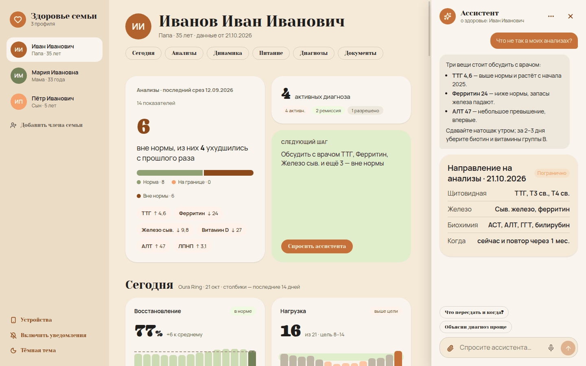
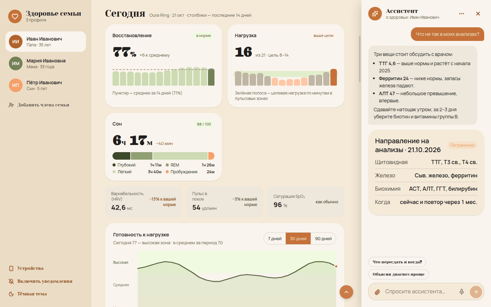
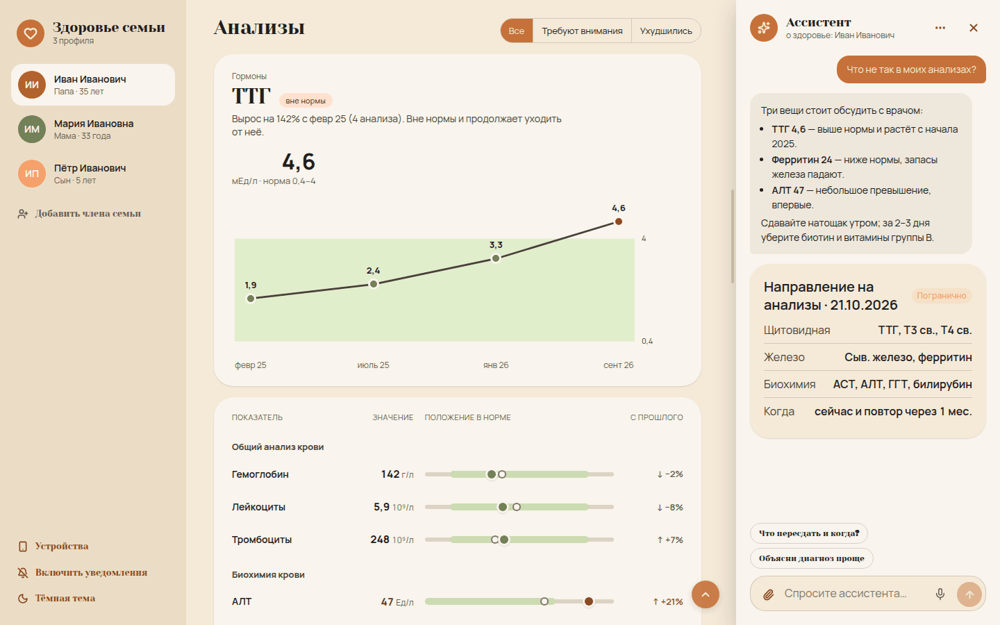
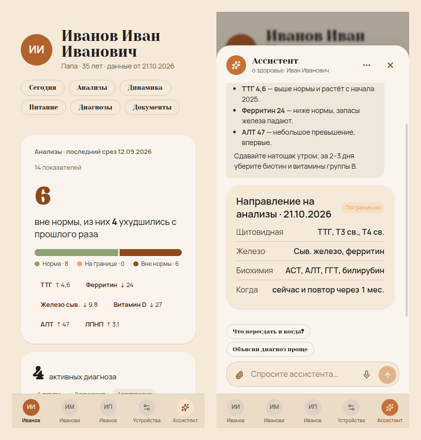
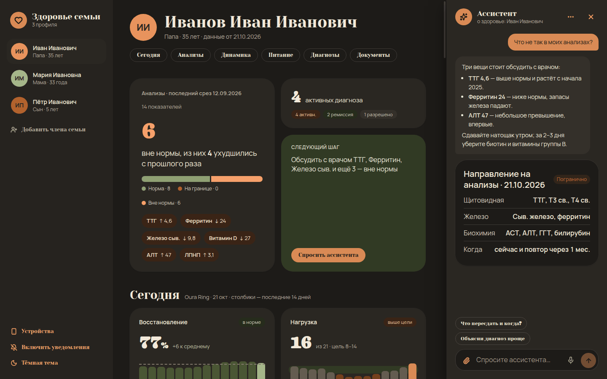

# Семейный дашборд здоровья

Self-hosted дашборд здоровья по членам семьи с интерактивным ассистентом Claude.

- **Слева** — выбор члена семьи (+ кнопка «Добавить члена семьи»).
- **В центре** — сводка, данные с часов, анализы с динамикой, питание, диагнозы, документы (загрузка drag&drop).
- **Справа** — чат с Claude: вопросы по анализам, генеративные виджеты/отчёты через **AG-UI**.
- Дизайн-система **Organic** (кремовый фон, терракота и шалфей), тёмная/светлая тема, интерфейс на русском.

## Скриншоты

> Все данные на скриншотах вымышленные.



**Сегодня** — восстановление, нагрузка и сон с часов/кольца, готовность к нагрузке за 7/30/90 дней:



**Анализы** — динамика выбранного показателя на фоне нормы и таблица с положением в референсе:



<table>
<tr>
<td width="50%"><b>Мобильная версия</b> — дашборд и ассистент в шторке<br></td>
<td width="50%"><b>Тёмная тема</b><br></td>
</tr>
</table>

## Архитектура

```
Браузер ──POST /api/chat──▶ Next.js ──tmux send-keys──▶ [tmux «health»: claude REPL]
                                                              │ вызывает MCP-инструменты
                                                              ▼
Браузер ◀──SSE /api/events── Next.js ◀──POST /api/ingest── health-ui MCP (дочерний к claude)
```

- **web/** — Next.js 15 (App Router). Читает данные из `data/`, раздаёт AG-UI события по SSE.
- **mcp/** — `health-ui` MCP-сервер: даёт Claude инструменты `emit_message`, `emit_widget`,
  `add_lab_results`, `save_diagnosis`, `file_document`, `update_member_json`, `run_finished`.
  Каждый инструмент пишет JSON и/или POST-ит AG-UI событие в Next.js (`/api/ingest`).
- **data/** — данные семьи: `family.json` + папка на каждого члена (`labs.json`, `diagnoses.json`,
  `metrics.json`, `documents.json` и папки-категории `Анализы/`, `Заключения/`, …). Это cwd Claude.
- **runtime/start-claude.sh** — поднимает tmux-сессию `health` с `claude`.

Структурированный вывод Claude идёт только через MCP-инструменты — терминал не парсится.

## Запуск

1. **Веб-сервер** (порт 3100, т.к. 3000 на этой машине занят другим сервисом):
   ```bash
   cd web && npm install && npm run build
   PORT=3100 npm start          # или: PORT=3100 npm run dev
   ```
   PIN по умолчанию `1234` (см. `web/.env.local`, переменная `HEALTH_PIN`).

2. **Сессия Claude** (нужна для чата и анализа документов):
   ```bash
   bash runtime/start-claude.sh        # создаёт tmux-сессию «health» с claude
   tmux attach -t health               # при желании понаблюдать за агентом
   ```
   Скрипт запускает `claude --dangerously-skip-permissions --mcp-config data/.mcp.json`,
   чтобы агент мог автономно читать файлы, двигать документы и вызывать MCP-инструменты без
   подтверждений. Запускайте только в доверенной среде. Веб-приложение поднимет сессию само при
   первом сообщении, но первый запуск удобнее сделать вручную и проверить, что Claude готов.

Открыть: <http://localhost:3100>

## Конфигурация (`web/.env.local`)

| Переменная | Назначение | По умолчанию |
|---|---|---|
| `HEALTH_DATA_DIR` | каталог данных семьи | `/opt/health/data` |
| `HEALTH_TMUX_SESSION` | имя tmux-сессии | `health` |
| `HEALTH_INGEST_SECRET` | секрет для `/api/ingest` (совпадает с `data/.mcp.json`) | `dev-ingest-secret` |
| `HEALTH_PIN` | PIN для входа | `1234` |
| `HEALTH_START_SCRIPT` | путь к `start-claude.sh` | `/opt/health/runtime/start-claude.sh` |

> Если меняете порт веб-сервера — обновите `HEALTH_INGEST_URL` в `data/.mcp.json` (сейчас `http://localhost:3100/api/ingest`).
